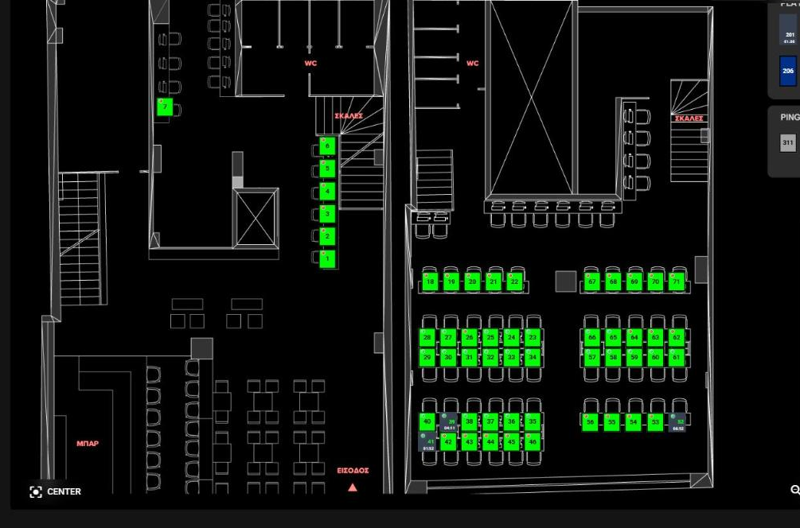
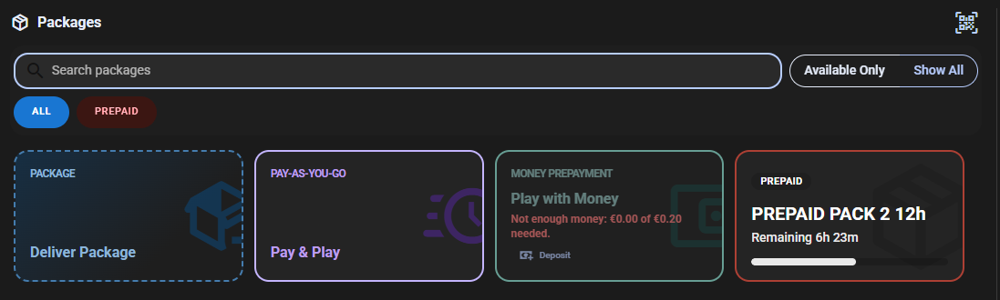
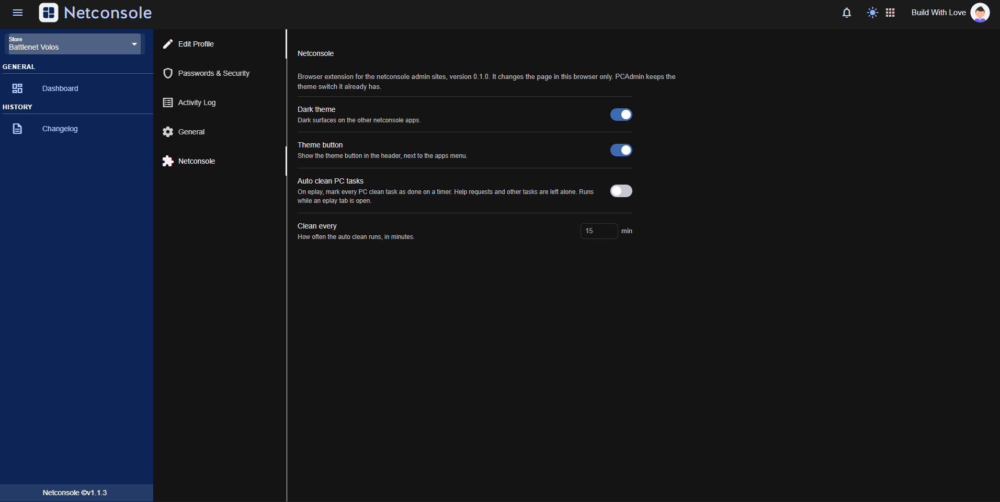
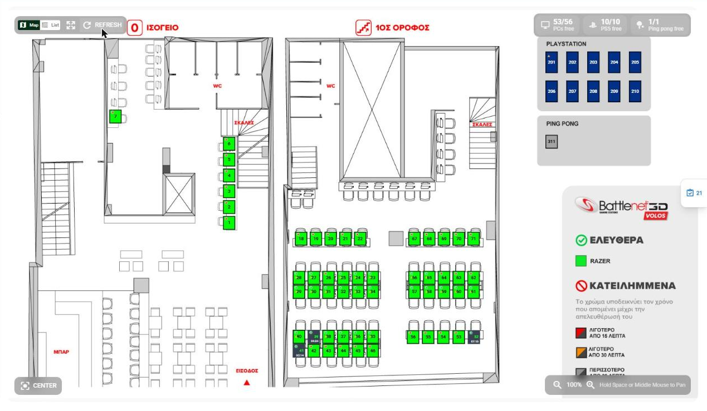
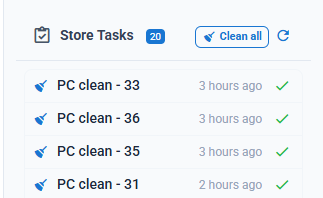
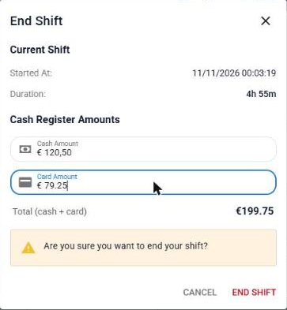
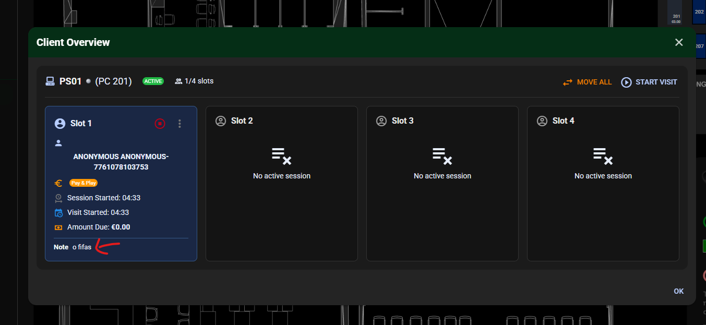

# Netconsole

A browser extension that adds small UI improvements to the netconsole.me admin sites (admin, eplay and the other subdomains). It only changes how the pages look and behave in your browser; it doesn't change anything on the server by itself.

Built with [WXT](https://wxt.dev) and TypeScript. Works in Chromium browsers (Chrome, Brave, Edge) and Firefox.

## Features

### Dark theme

A dark theme for every netconsole app except PCAdmin, which has its own theme switch. Turn it on from the settings panel or with the theme button the extension adds to the header, next to the apps menu.



This includes the eplay **Start Visit → Select Package** step: the search bar, filter pills, action cards (Deliver Package, Pay & Play, Play with Money) and the rental gear list.



### Settings panel

On **admin.netconsole.me/me** there's a new **Netconsole** tab with the extension's settings:

| Setting | What it does |
|---|---|
| Dark theme | Dark surfaces on the netconsole apps |
| Theme button | Shows the theme button in the header |
| Auto clean PC tasks | Marks every PC clean task as done on a timer (see below) |
| Clean every | How often auto clean runs, in minutes |

Settings are stored by the extension, so they apply to every netconsole subdomain.



### Client breakdown on the Clients map (eplay)

The stats pill on the Clients map shows free / total per kind of client, in place of the original Occupied / Free / Out of order / Total chips. Hover a chip to see occupied, free, out-of-order and total counts.




The counts come from the response of `GET /api/stores/{store}/clients/active` that eplay already makes. PCs are grouped together, and other clients are grouped by their group name (PS5, ping pong and so on), so a new kind of client shows up on its own.

### Store Tasks: Clean all and auto clean (eplay)

The **Store Tasks** drawer gets a **Clean all** button that marks every PC clean task as done in one click.



With **Auto clean PC tasks** turned on in settings, the same clean runs every N minutes while an eplay tab is open. Several open tabs share one timer, so they don't all clean at once.

Only tasks of type `CLEAN_PC` are resolved. Help requests, client disconnects and self-start checks are left alone. The extension makes the same request eplay makes when you click a task's ✓ (`DELETE /api/stores/{store}/tasks/{id}`), reusing the login headers eplay itself sends. Those headers stay in memory and are never saved.

### End Shift total (eplay)

The End Shift dialog shows the cash and card amounts added together, updating as you type. Commas and dots both work as the decimal separator.



### Visit notes (eplay)

When you open a visit's overview, the customer's active notes and the visit's own note show on the client card.


## Development

### Requirements

- Node.js (a recent LTS or newer; developed on Node 26) and npm
- Chrome, Brave or Edge, and/or Firefox 128 or newer

### Install

```bash
npm install
```

This also runs `wxt prepare`, which generates the `.wxt/` types.

> The npm scripts call `scripts/run-wxt.mjs` instead of `wxt` directly. It adds a Node flag that newer Node versions need for `wxt prepare` to work. Use the npm scripts rather than running `wxt` yourself.

### Run the dev browser

WXT opens a separate browser with the extension already loaded and reloads it whenever you save a file.

Chromium:

```bash
npm run dev
```

If Brave is installed in its default Windows location, the dev browser is Brave (set in `wxt.config.ts`). Otherwise WXT uses Chrome.

Firefox:

```bash
npm run dev:firefox
```

The dev browser uses a fresh profile, so you need to sign in to netconsole there once. Stop it with Ctrl+C in the terminal.

### Type check

```bash
npm run typecheck
```

## Building and loading the extension

### Chromium browsers (Chrome, Brave, Edge)

1. Build:

   ```bash
   npm run build
   ```

   The extension is written to `.output/chrome-mv3/`.

2. Open the extensions page:
   - Chrome: `chrome://extensions`
   - Brave: `brave://extensions`
   - Edge: `edge://extensions`
3. Turn on **Developer mode** (top right in Chrome and Brave, left sidebar in Edge).
4. Click **Load unpacked** and select the `.output/chrome-mv3` folder.

After a rebuild, click the reload icon on the extension's card and refresh the netconsole tabs.

### Firefox

1. Build:

   ```bash
   npm run build:firefox
   ```

   The extension is written to `.output/firefox-mv3/`.

2. Open `about:debugging#/runtime/this-firefox`.
3. Click **Load Temporary Add-on…** and select `.output/firefox-mv3/manifest.json`.

Temporary add-ons are removed when Firefox closes. To keep it installed, build a zip and have it signed through [addons.mozilla.org](https://addons.mozilla.org/developers/) (an unlisted add-on is fine for internal use):

```bash
npm run zip:firefox
```

### Zips for distribution

```bash
npm run zip
```

```bash
npm run zip:firefox
```

The zips are written to `.output/`.

## Project layout

```
entrypoints/
  netconsole.content.ts   Runs the patches below on every netconsole page
  visit.content.ts        Runs in the page itself: reads eplay API responses, sends task clean requests
src/
  settings.ts             Settings stored by the extension
  client-stats.ts         Groups clients by kind for the breakdown pill
  visit-notes.ts          Pulls notes out of a visit response
  store-tasks.ts          Messages for the task cleaner
  task-cleaner.ts         Lists and resolves PC clean tasks
  patches/
    index.ts              List of patches
    theme.ts              Dark theme and header button
    account.ts            Settings panel on admin.netconsole.me/me
    client-types.ts       Client breakdown pill
    store-tasks.ts        Clean all button and auto clean timer
    shift-total.ts        End Shift total
    visit-note.ts         Notes on the client card
    patches.css           All styles, including the dark theme
docs/screenshots/         Images used in this README
```
